<h1 align="center">Hi 👋, I'm Ahmad</h1>

  <b>Chartered Accountant turned AI engineer — building agents, RAG systems and Python web apps where finance meets AI</b> 
  Big 4 audit & taxation · MNC finance · ACCA · CPA Pakistan · MSc Professional Accountancy · BSc Computer Science (Data Science)

  
  

---

### 🧭 About me

I've loved programming since childhood, took a detour into finance — Big 4 audit, taxation and investment analysis — and I'm now back to code, building tools where **finance meets AI**.

- 🤖 **Building:** AI agents with **LangGraph** and **Pydantic AI**, web & mobile apps, and tooling for AI coding agents ([RelayDeck](https://github.com/Hybridhash/relaydeck))
- 🧪 **Exploring:** RAG pipelines, retrieval-quality improvements and custom datasets for task-based fine-tuning
- 📄 **Applying it to finance:** document & invoice extraction, financial dashboards and automation
- 💬 **Ask me about:** agents, RAG, FastAPI, Litestar, HTMX, React — or anything accounting & audit

---

### 🚀 Featured projects

| Project | What it is | Stack |
|---|---|---|
| [**RelayDeck**](https://github.com/Hybridhash/relaydeck) | Remote control for the AI coding agents and shells running on your Mac — watch, answer and start them from your phone, tablet or browser. Nothing leaves your Mac. | Python, Flet, FastAPI, WebSockets |
| [**FastAPI-HTMX**](https://github.com/Hybridhash/FastAPI-HTMX) | Boilerplate for server-rendered apps with FastAPI + HTMX | FastAPI, HTMX, Alpine.js, SQLAlchemy |
| [**Litestar-HTMX**](https://github.com/Hybridhash/litestar-fullstack) | My fork of Litestar Fullstack, adapted for HTMX | Litestar, HTMX, Advanced Alchemy |

---

### 🛠️ Tech stack

**🤖 AI Agents & LLMs**

  
  
  
  
  
  
  

**🧠 ML & Data**

  

**⚙️ Backend & Databases**

  
   
  
  
  

**🎨 Frontend**

  
   
  
  
  

**📱 Mobile & Desktop**

  
   
  
  

Also: pandas, seaborn, Selenium, Playwright, pytest, Chart.js, Git & GitHub Actions

---

### 🎓 Education & qualifications

  

---

### 🎾 Off-market hours

  

---

### 📊 GitHub stats

  
  

  

